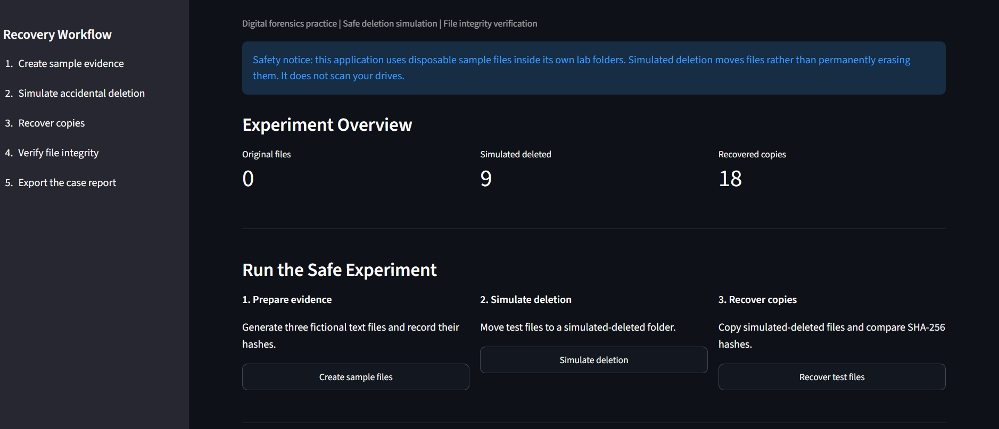

# Lost Data Retrieval Lab 🔎

A Python-based digital forensics learning project that demonstrates
safe file-deletion simulation, recovery-copy workflows, SHA-256
integrity verification, evidence logging, and case-report generation.

## 🚀 Live Demo

**Try the application online:** [Lost Data Retrieval Lab](https://lostdataretrievallab.streamlit.app/)

Explore the simulated file-recovery workflow, SHA-256 integrity verification, recovery analytics, and downloadable JSON case reports.



## Features

- Safe simulation of accidental file deletion
- Creation of disposable sample files
- SHA-256 file-integrity verification
- Recovery-copy creation and verification
- Evidence manifest and activity logs
- Recovery analytics dashboard
- Downloadable JSON case report
- Streamlit web interface

## Technology Stack

- Python
- Streamlit
- Pandas
- hashlib
- pathlib
- JSON

## Project Structure

```text
LostDataRetrievalLab/
├── app.py
├── recovery_engine.py
├── requirements.txt
├── README.md
├── .gitignore
├── evidence/
│   └── .gitkeep
└── lab_data/
    └── .gitkeep
```

## Installation

Create and activate a virtual environment on Windows:

```bash
python -m venv .venv
.venv\Scripts\activate
```

Install dependencies:

```bash
python -m pip install -r requirements.txt
```

Run the application:

```bash
python -m streamlit run app.py
```

## How It Works

1. Generate disposable sample text files.
2. Record original file hashes in an evidence manifest.
3. Move test files into a simulated-deleted folder.
4. Create recovery copies in a separate lab folder.
5. Compare recovered-file hashes with the saved originals.
6. Review the activity log and export a JSON report.

## Digital Forensics Concepts

This project introduces file handling, evidence documentation,
cryptographic hashing, integrity verification, and recovery reporting.

## Important Limitations

This version simulates deletion by moving files between folders.
It does not recover data from a physical drive or directly analyze
FAT32 or NTFS file-system structures.

A matching SHA-256 hash indicates that a recovered copy matches
the recorded original. It does not demonstrate successful recovery
from a real deleted-file scenario.

Real recovery outcomes depend on the storage device, file system,
and whether deleted data has been overwritten.

## Future Improvements

- Actual recovery experiments using authorized test media
- File-system metadata analysis
- More detailed forensic reports
- Recovery-result charts
- Case management and evidence export

## Author

Developed as an educational cybersecurity and digital forensics
portfolio project.

Add your name, GitHub repository link, and screenshots before
publishing the project.
